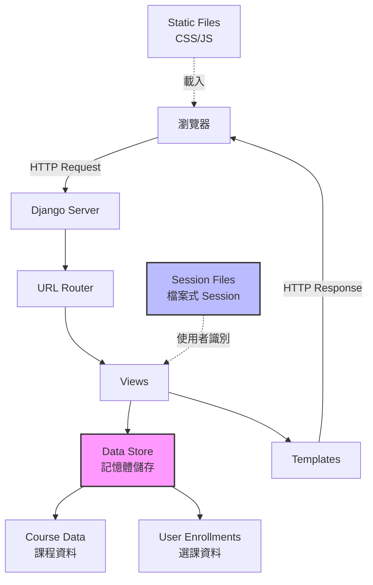
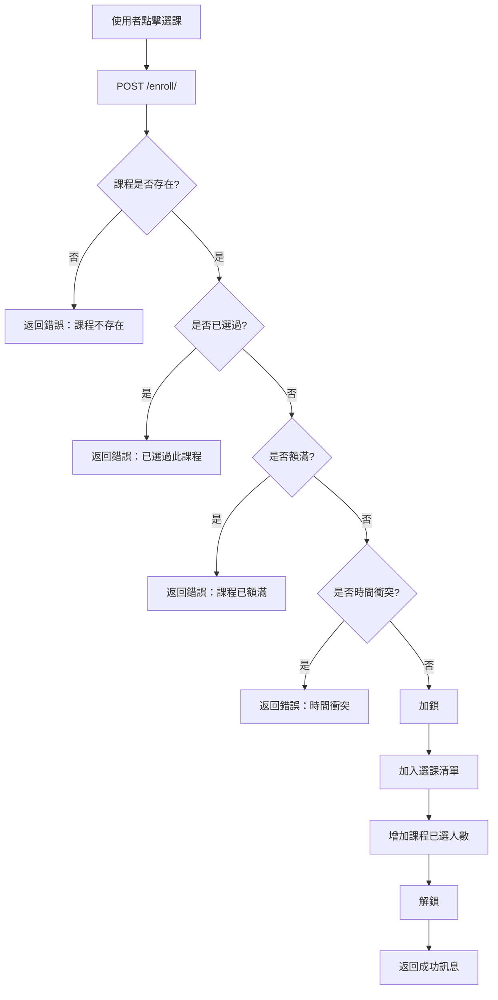
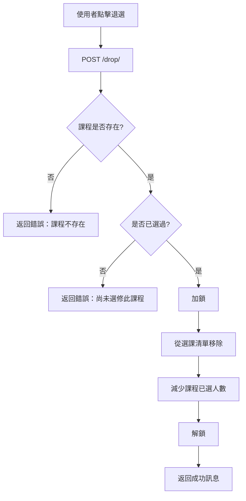

# 系統架構文件

## 一、專題背景與目標

### 專題背景
本專題為 Django 期中作業，要求開發一套個人課表維護系統，用於管理大學生的選課與課程安排。系統需要特別注重選課規則、課程衝突檢查及名額管理，確保選課流程的合理性與正確性。

### 專題目標
1. 提供完整的課程瀏覽與搜尋功能
2. 支援選課、退選及課表維護
3. 實作課程時間衝突檢查
4. 實作課程名額管理與占用
5. 確保選課規則的正確執行
6. 提供清楚的每週課表視覺化
7. 不使用任何資料庫，採用記憶體儲存
8. 適合 Windows 本機環境執行與課堂展示

## 二、系統需求與功能範圍

### 功能需求
1. **課程清單**
   - 顯示所有課程
   - 關鍵字搜尋（課程名稱、教師、課程編號）
   - 課程類型篩選（必修、選修、通識）
   - 星期篩選
   - 顯示課程名額狀態

2. **個人課表維護**
   - 選課（新增課程至個人課表）
   - 退選（移除已選課程）
   - 查看已選課程
   - 每週課表視覺化
   - 學分統計

3. **課程時間衝突檢查**
   - 檢測同一天、節次重疊的課程
   - 拒絕衝突選課並提示原因
   - 允許不同星期或不重疊時段的課程

4. **課程名額管理**
   - 共用課程名額（所有使用者）
   - 額滿課程拒絕選課
   - 退選後釋放名額
   - 防止重複選課
   - 防止名額超額或負數

5. **選課合理性檢查**
   - 課程是否存在
   - 是否重複選課
   - 是否已額滿
   - 是否時間衝突
   - 資料合法性驗證

### 非功能需求
1. 不使用任何資料庫
2. 採用記憶體儲存
3. 繁體中文介面
4. 響應式設計
5. 適合 Windows 本機執行
6. 可在課堂展示

## 三、使用技術與選用原因

### 後端技術
| 技術 | 版本 | 選用原因 |
|------|------|----------|
| Django | 6.1.2 | 成熟的 Python Web 框架，符合專題需求 |
| Python | 3.12 | 最新穩定版本，效能與安全性佳 |
| python-decouple | 3.8 | 環境變數管理，保護機敏資訊 |
| python-pptx | 0.6.23 | 程式化產生 PowerPoint 簡報 |

### 前端技術
- **Django Templates：** 伺服器端模板渲染，不採用前後端分離
- **原生 CSS：** 不使用框架，完全客製化樣式
- **原生 JavaScript：** 輕量化互動功能

### 資料儲存
- **記憶體儲存：** Python 字典與集合，不使用資料庫
- **檔案式 Session：** Django Session 儲存於檔案系統

### 選用原因說明
1. **Django：** 專題指定技術，提供完整的 MTV 架構
2. **無資料庫：** 符合專題限制，簡化部署與展示
3. **記憶體儲存：** 快速存取，適合課堂展示規模
4. **Django Templates：** 符合不採用前後端分離的要求
5. **原生技術：** 避免過度複雜，專注核心功能

## 四、系統架構圖



## 五、Django MTV 架構說明

### Model（資料模型）
本專題不使用 Django ORM Model，改用純 Python 類別與資料結構：

- **Course 類別：** 使用 `@dataclass` 定義課程資料結構
- **CourseDataStore 類別：** 單例模式管理所有課程與選課資料
- **記憶體儲存：** Python 字典（dict）與集合（set）

### Template（模板）
使用 Django Templates 渲染 HTML：

- **base.html：** 基礎模板，包含導航列與頁尾
- **index.html：** 首頁，顯示每週課表
- **course_list.html：** 課程清單與搜尋
- **course_detail.html：** 課程詳細資訊
- **my_courses.html：** 我的課表
- **system_info.html：** 系統資訊

### View（視圖）
處理所有業務邏輯與請求：

- **index：** 首頁與每週課表
- **course_list：** 課程清單與搜尋
- **course_detail：** 課程詳情
- **my_courses：** 我的課表
- **enroll_course：** 選課操作（POST）
- **drop_course：** 退選操作（POST）
- **system_info：** 系統資訊

### URL Routing
- **專案層級：** `timetable_project/urls.py`
- **應用程式層級：** `timetable/urls.py`

## 六、專案目錄結構

```
Class-Schedule/
│
├── timetable_project/          # Django 專案設定
│   ├── __init__.py
│   ├── settings.py             # 設定檔（移除資料庫、使用檔案式 Session）
│   ├── urls.py                 # 主 URL routing
│   ├── wsgi.py                 # WSGI 入口
│   └── asgi.py                 # ASGI 入口
│
├── timetable/                  # 主要應用程式
│   ├── __init__.py
│   ├── data_store.py           # 課程資料儲存與管理（核心邏輯）
│   ├── views.py                # 視圖處理
│   ├── urls.py                 # App URL routing
│   ├── apps.py                 # App 設定
│   └── admin.py                # （未使用，無 Admin）
│
├── templates/                  # HTML 模板
│   ├── base.html               # 基礎模板
│   ├── index.html              # 首頁
│   ├── course_list.html        # 課程清單
│   ├── course_detail.html      # 課程詳情
│   ├── my_courses.html         # 我的課表
│   └── system_info.html        # 系統資訊
│
├── static/                     # 靜態資源
│   ├── css/
│   │   └── style.css           # 主要樣式表
│   └── js/
│       └── main.js             # JavaScript
│
├── docs/                       # 文件
│   ├── SYSTEM_ARCHITECTURE.md  # 本文件
│   ├── DEMO_SCRIPT.md          # 展示腳本
│   ├── ACCEPTANCE_CHECKLIST.md # 驗收清單
│   └── 個人課表維護系統_期中報告.pptx
│
├── scripts/                    # 腳本
│   └── generate_presentation.py # 產生簡報
│
├── sessions/                   # Session 檔案儲存（自動產生）
├── .venv/                      # Python 虛擬環境（不納入版本控制）
│
├── manage.py                   # Django 管理工具
├── start.bat                   # Windows CMD 啟動腳本
├── start.ps1                   # PowerShell 啟動腳本
├── requirements.txt            # Python 依賴
├── .env                        # 環境變數（不納入版本控制）
├── .env.example                # 環境變數範例
├── .gitignore                  # Git 忽略檔案
└── README.md                   # 專案說明
```

## 七、資料結構設計

### 課程資料結構（Course）

```python
@dataclass
class Course:
    course_id: str          # 課程編號（主鍵）
    name: str               # 課程名稱
    teacher: str            # 授課教師
    weekday: int            # 星期（1-7）
    start_period: int       # 開始節次
    end_period: int         # 結束節次
    credits: int            # 學分
    course_type: str        # 課程類型（必修/選修/通識）
    target_class: str       # 開課班級
    total_quota: int        # 總名額
    enrolled_count: int     # 已選人數
```

### 儲存結構（CourseDataStore）

```python
class CourseDataStore:
    # 課程目錄（所有課程）
    courses: Dict[str, Course]  # course_id -> Course
    
    # 使用者選課清單
    user_enrollments: Dict[str, Set[str]]  # user_id -> Set[course_id]
    
    # 執行緒鎖定（防止並發問題）
    lock: threading.Lock
```

### 使用者識別
- **使用者 ID：** Django Session Key
- **Session 儲存：** 檔案式（sessions/ 目錄）
- **使用者選課：** 以 user_id 為鍵的集合

## 八、選課與退選處理流程

### 選課流程



### 退選流程



## 九、課程衝突檢查

### 判斷方式

1. **同一星期檢查：** 只有同一星期的課程才可能衝突
2. **節次重疊檢查：** 使用區間重疊演算法

```python
def _periods_overlap(start1, end1, start2, end2):
    """
    檢查兩個時段是否重疊
    不重疊條件：end1 < start2 或 end2 < start1
    重疊條件：上述條件的否定
    """
    return not (end1 < start2 or end2 < start1)
```

### 範例

| 課程 A | 課程 B | 是否衝突 | 說明 |
|--------|--------|----------|------|
| 週一 2-4 | 週一 3-5 | ✗ 衝突 | 節次 3、4 重疊 |
| 週一 2-4 | 週一 5-7 | ✓ 不衝突 | 節次不重疊 |
| 週一 2-4 | 週二 2-4 | ✓ 不衝突 | 不同星期 |
| 週一 2-4 | 週一 4-6 | ✗ 衝突 | 節次 4 重疊 |

## 十、URL 路由與主要頁面

| URL | 名稱 | 方法 | 說明 |
|-----|------|------|------|
| `/` | index | GET | 首頁，顯示每週課表 |
| `/courses/` | course_list | GET | 課程清單與搜尋 |
| `/courses/<course_id>/` | course_detail | GET | 課程詳細資訊 |
| `/my-courses/` | my_courses | GET | 我的課表 |
| `/enroll/` | enroll_course | POST | 選課操作 |
| `/drop/` | drop_course | POST | 退選操作 |
| `/system-info/` | system_info | GET | 系統資訊 |

## 十一、重要業務邏輯說明

### 1. 單例模式（Singleton Pattern）
`CourseDataStore` 使用單例模式確保所有請求共用同一份資料：

```python
class CourseDataStore:
    _instance = None
    _lock = threading.Lock()
    
    def __new__(cls):
        if cls._instance is None:
            with cls._lock:
                if cls._instance is None:
                    cls._instance = super().__new__(cls)
        return cls._instance
```

### 2. 執行緒鎖定（Thread Lock）
選課與退選使用鎖定機制防止並發問題：

```python
def enroll_course(self, user_id, course_id):
    with self.lock:
        # 選課邏輯
        ...
```

### 3. 使用者識別
使用 Django Session Key 作為使用者 ID：

```python
def get_user_id(request):
    if 'user_id' not in request.session:
        if not request.session.session_key:
            request.session.create()
        request.session['user_id'] = request.session.session_key
    return request.session['user_id']
```

### 4. 課程名額共用
所有使用者共用同一個 `CourseDataStore` 實例，確保名額一致：

```python
# 全域單例
course_store = CourseDataStore()

# 所有 View 使用同一個 instance
from .data_store import course_store
```

## 十二、Session 與記憶體儲存設計

### Session 設定
```python
# settings.py
SESSION_ENGINE = 'django.contrib.sessions.backends.file'
SESSION_FILE_PATH = BASE_DIR / 'sessions'
SESSION_COOKIE_AGE = 86400  # 1天
SESSION_SAVE_EVERY_REQUEST = True
```

### 記憶體儲存限制
1. **重啟後重置：** 伺服器重啟後所有資料回到初始狀態
2. **無法跨程序：** 多個 Worker 或程序無法共用記憶體
3. **單程序執行：** 本專題採用單一 Django 程序

### 示範資料
系統啟動時自動載入 24 門示範課程：
- 資訊工程系課程 10 門
- 通識課程 8 門
- 體育與藝術課程 4 門
- 測試用課程 2 門（小名額、時段衝突）

## 十三、機敏資訊保護

### .env 設定
```
SECRET_KEY=...
DEBUG=True
ALLOWED_HOSTS=localhost,127.0.0.1
```

### .gitignore 規則
```
.env
.env.*
!.env.example
.venv/
__pycache__/
*.pyc
sessions/
```

### 安全措施
1. `.env` 未納入版本控制
2. `.env.example` 僅含示範值
3. SECRET_KEY 從環境變數讀取
4. 不將密碼或金鑰寫死在程式碼

## 十四、本機環境安裝與啟動

### 1. 環境需求
- Windows 10/11
- Python 3.12 或以上
- PowerShell 或 CMD

### 2. 安裝步驟
```powershell
# Clone 專案
git clone https://github.com/11346070/Class-Schedule.git
cd Class-Schedule

# 建立虛擬環境
python -m venv .venv

# 啟動虛擬環境（PowerShell）
.venv\Scripts\Activate.ps1

# 安裝依賴
pip install -r requirements.txt

# 建立 .env
copy .env.example .env

# 系統檢查
python manage.py check
```

### 3. 啟動方式

**方式一：使用啟動腳本**
```powershell
.\start.ps1
```

**方式二：手動啟動**
```powershell
python manage.py runserver 127.0.0.1:8000
```

### 4. 訪問系統
```
http://127.0.0.1:8000
```

## 十五、系統操作流程

1. **瀏覽課程**
   - 訪問首頁或課程清單
   - 使用搜尋與篩選功能

2. **選課**
   - 在課程清單點擊「選課」
   - 系統檢查衝突與名額
   - 選課成功後更新課表

3. **查看課表**
   - 在首頁查看每週課表
   - 在我的課表查看詳細列表

4. **退選**
   - 在我的課表或首頁點擊「退選」
   - 確認後釋放名額

5. **查看課程詳情**
   - 點擊課程名稱或「詳情」按鈕
   - 查看完整課程資訊與選課狀態

## 十六、手動驗收項目

請參閱 [docs/ACCEPTANCE_CHECKLIST.md](ACCEPTANCE_CHECKLIST.md)

## 十七、已知限制與取捨

### 限制
1. **資料不持久化：** 伺服器重啟後資料重置
2. **無法擴充至多程序：** 記憶體無法跨程序共用
3. **Session 依賴檔案系統：** 無法用於無檔案系統環境
4. **無使用者註冊登入：** 僅用 Session 識別使用者

### 取捨說明
- **不使用資料庫：** 專題明確要求
- **記憶體儲存：** 符合專題規模與展示需求
- **單程序執行：** 簡化實作，適合課堂展示
- **無認證系統：** 專注課表功能，簡化實作

## 十八、未來可擴充功能

1. **資料持久化**
   - 加入資料庫（SQLite、PostgreSQL）
   - 使用 Django ORM

2. **使用者認證**
   - 註冊與登入
   - 密碼加密
   - 權限管理

3. **進階選課規則**
   - 學分上限限制
   - 先修課程檢查
   - 年級限制

4. **通知功能**
   - Email 通知
   - 課程變更提醒

5. **課程評價**
   - 學生評價系統
   - 課程評分

6. **API 介面**
   - RESTful API
   - 支援前後端分離

7. **匯出功能**
   - 匯出課表為 PDF
   - 匯出課表為 iCal

## 十九、效能考量

### 優點
- **記憶體存取快速：** 無資料庫 I/O
- **簡單架構：** 易於理解與維護
- **適合小規模：** 符合課堂展示需求

### 限制
- **記憶體占用：** 所有資料常駐記憶體
- **無法水平擴充：** 單程序限制
- **無資料持久化：** 重啟後資料遺失

### 適用場景
- 課堂展示與教學
- 小規模選課系統（< 1000 使用者）
- 開發與測試環境

## 二十、結論

本系統成功實作了完整的個人課表維護功能，特別注重選課規則、課程衝突檢查及名額管理。雖然採用記憶體儲存有其限制，但符合專題需求且適合課堂展示。系統架構清楚、程式碼易讀，適合作為 Django 學習與展示的範例專題。

---

**文件版本：** 1.0  
**最後更新：** 2026-10-26  
**作者：** 個人課表維護系統開發團隊
